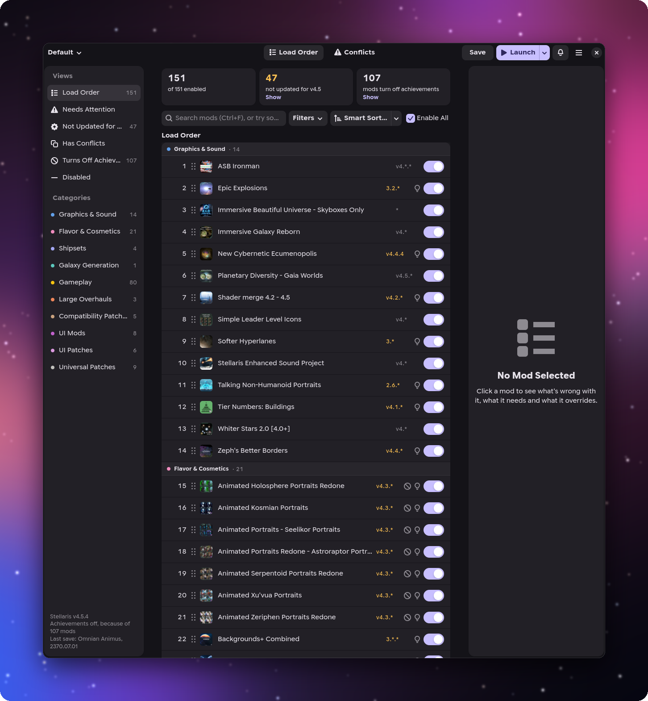
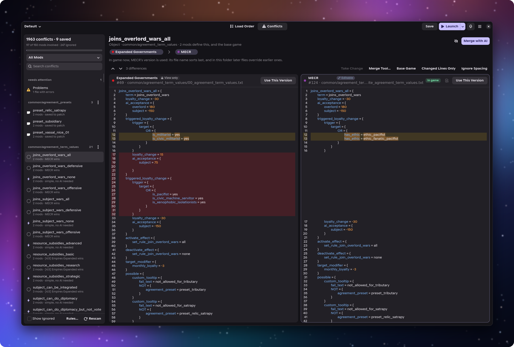
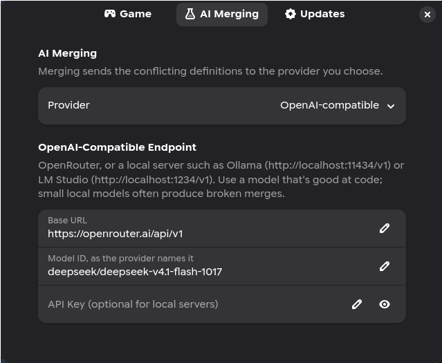
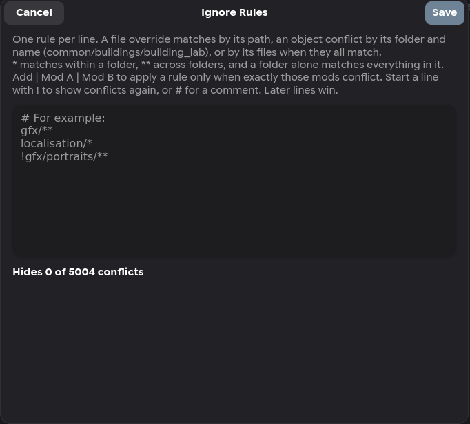

<div align="center">


# DrukhalManager

A Stellaris mod manager for Linux that can merge conflicting mods with AI.

[](https://github.com/Dukko/DrukhalManager/releases/latest)
[](https://github.com/Dukko/DrukhalManager/actions/workflows/ci.yml)
[](#installing)
[](LICENSE)



</div>

I play Stellaris on Linux with around 150 mods, and two things kept messing up my evenings: working out which mods overwrite each other, and fixing the load order after every Steam update. [Irony Mod Manager](https://github.com/bcssov/IronyModManager) solves the first one well, but I wanted something native to my desktop that could also do the annoying and boring parts of merging for me. DrukhalManager is an opinionated fork of Irony, rewritten in Rust and GTK 4.

It does the usual mod manager things (load orders, collections, Paradox Launcher playsets) and a few **less usual** ones:

* Shows every file and object that more than one mod changes, side by side, and tells you which version the game ends up using and why.
* Merges two conflicting versions with Claude or any OpenAI-compatible model, using the base game's version as a reference, and saves the result to a patch mod that loads last. Your mods are never touched.
* Merges the easy ones without AI: if only one mod actually changed something, let's not burn computing power for no reason.
* Sorts your load order the way the community guides suggest, with sub-mods under the mod they belong to.
* Remembers which mods each campaign was played with, and can freeze a collection so a Workshop update doesn't break a game in progress (like Irony's collection merge, but faster).

### Should you use it?

Probably not if you play anything other than Stellaris; Irony supports several Paradox games and has years more testing behind it. AI merging also isn't free or magic. Each merge is an API call you pay for (or a local model you run), and you should read what comes back before saving it. DrukhalManager shows you a cost estimate and the full result, but you still need to know what's going on and not mash accept.

## Installing

### Flatpak (any distro)

```sh
flatpak install --user https://dukko.github.io/DrukhalManager/io.github.dukko.DrukhalManager.flatpakref
```

Updates arrive with `flatpak update` or your software centre. DrukhalManager also tells you when a new version is out and can install it for you (**Preferences → Updates**). The GNOME runtime comes from Flathub, and the repository is signed with [`flatpak/drukhal-manager.gpg`](flatpak/drukhal-manager.gpg).

<details>
<summary>Offline installs, self-updates, and Steam on another drive</summary>

<br>

**Offline:** download `DrukhalManager.flatpak` from the [latest release](https://github.com/Dukko/DrukhalManager/releases/latest) and run `flatpak install --user DrukhalManager.flatpak`. It updates from the same repository. If you installed the 0.1.0 bundle, install once more by either method to get updates.

**Updating from inside the app** works from 0.2.2 on; on 0.2.0 or 0.2.1, run `flatpak update` once. The first time, Flatpak asks whether DrukhalManager may update itself. Desktops without a portal for that question, such as niri or sway, can't show it, so allow it yourself:

```sh
flatpak permission-set flatpak updates io.github.dukko.DrukhalManager yes
```

**Steam elsewhere:** the sandbox can see your home folder. If Steam or a Steam library lives somewhere else, such as another drive, DrukhalManager shows the command that grants access:

```sh
flatpak override --user --filesystem=/path/to/Steam io.github.dukko.DrukhalManager
```

In the Flatpak, **Launch** starts the game through Steam.

</details>

### Arch or CachyOS

```sh
cd packaging/arch
makepkg -si
```

This installs `drukhal-manager` with a desktop entry and icon.

## Load order

Drag mods around, type a position into the number, or press **Smart Sort**. Ctrl+click or Shift+click to select several mods, then enable, disable, move or categorise them all at once. Undo, Redo and Reload sit at the top left of the window. The strip above the list counts what needs looking at, like mods that haven't been updated for your game version or mods loading before something they depend on, and each count has a button that shows you which ones. The count of mods not updated for your game also offers **Disable for Now…**, which keeps your full load order as a collection first.

Smart Sort follows the order the community guides use: unofficial patches (`~`) first, then graphics, flavor, shipsets, galaxy generation, gameplay, large overhauls, compatibility patches, UI mods, UI patches, and universal patches (`!`) last. It decides where a mod goes from its name, its dependencies and the folders it ships, because Workshop tags are often wrong. You get a preview before anything moves, and if it puts a mod in the wrong place you can move it and it'll remember.

The search box takes filters as well as names. `enabled:yes conflicts:yes` lists the enabled mods with conflicts, `source:local || giga` finds local mods or anything called giga, and `--` leaves things out. If you don't want to remember the syntax, the **Filters** button builds the filter for you.

Also on this page:

* **Collections** are named load orders, each synced to its own Paradox Launcher playset. You can import a playset, a Workshop collection link, or a load order a friend pasted, and **Copy Load Order** gives you a numbered list with Workshop links to paste back.
* **Notes** on a mod, for things like "keep this below UIOD or the outliner breaks". Search finds them.
* **Freeze This Collection…** copies its Workshop mods into local ones, so you can finish a campaign on the versions you started with.
* **Extra Mod Folder** (Preferences → Game) loads mods kept elsewhere, such as on another drive, and a collection's merged patch can be moved there too.
* **Find Compatibility Patches…** searches the Workshop for patches between mods you run that you haven't subscribed to. It's on the Compatibility Patches header in the list, or in the sidebar while you have none. It needs a Steam Web API key (**Preferences → Steam**).
* **Descriptor repair** fixes `.mod` files pointing at folders that no longer exist, after backing them up.

## Conflicts



Pick a conflict on the left and you get two versions next to each other with the differences highlighted. The one the game actually loads is marked **In game**, along with the reason: its file name sorts last, the folder keeps the first definition it reads, or it's simply later in the load order. Conflicts marked ⚡ are the simple kind, where only one mod changed anything or every mod ships the same thing.

The right-hand version is editable, so you can fix things by hand. **Take Change** copies a single difference across, **Changed Lines Only** hides the parts that match, and **Base Game** compares against the vanilla file instead. If you'd rather use Meld or KDiff3, **Merge Tool…** opens both versions there.

Most of the noise in a big mod list is graphics and localisation files I usually don't care about. You can ignore one conflict, a folder, or a pattern like `gfx/**`, and the rule editor tells you how many conflicts each rule hides.

| Shortcut | Does |
| --- | --- |
| Alt+Page Down / Alt+Page Up | Next / previous conflict |
| Alt+Left / Alt+Right | Use the left / right version |
| Alt+M | Merge with AI |
| Alt+I | Ignore the conflict |

## Merging with AI

**Merge with AI** sends both versions, and the base game's when there is one, to the model you've picked in Preferences. With three or more mods it works through them one at a time, merging the result with the next mod's version until you're left with one to review. **Merge All** does a whole folder and tells you roughly how many calls and how much money that'll be before it starts.

The model only ever sees the conflicting definitions, not your whole mod folder. When it returns something with broken syntax, it gets one more try with the error message before the merge counts as failed.

Results go into a merged patch mod, one per collection, that loads last. If one of the mods or the game updates later, the merges that depended on it are flagged as outdated. Where you picked one mod's version and only that mod changed, one click takes its new version. The patch is backed up before every Merge All, and the backups button at the bottom of the Conflicts list keeps the last ten.

<table>
<tr>
<td width="50%"></td>
<td width="50%"></td>
</tr>
<tr>
<td>Claude, OpenRouter, or a local server like Ollama or LM Studio.</td>
<td>Ignore rules, with a count of what each one hides.</td>
</tr>
</table>

API keys go in your system keyring. Without a keyring they're stored in a settings file only your user can read.

## Launching

**Launch** starts the game with your load order. Its dropdown holds the other ways in:

* **Continue** loads your last save straight away. If Steam updated any of your mods since you last played, or the Workshop has updates Steam hasn't downloaded yet, the health strip says which, with links to their change notes.
* **Saves…** lists the campaigns you started from DrukhalManager and the mods each one was played with.
* **Multiplayer Check…** saves a report of your game and mod files for multiplayer desyncs. Swap reports with the other players and open theirs, and it lists the files that differ.
* **DLC…** turns DLC on or off for your next game.
* **Find the Crashing Mod…** turns off half your mods, has you launch the game, and keeps halving until it finds the one that crashes. Your load order is put back afterwards.

## When something goes wrong

If the last game logged errors, the bottom of the sidebar says how many; click it to see them grouped by the mod they came from. The bell in the header keeps every notification, so you can go back to one you missed. If you hit a bug, **Main Menu → Troubleshooting** copies a short report you can paste into an issue. It comes from a small log of scans, merges, AI calls and game launches, and never includes API keys, prompts or file contents.

There's a longer how-to for each of these in the [wiki](https://github.com/Dukko/DrukhalManager/wiki).

## Building

Requires Rust, GTK 4.14+ and libadwaita 1.8+ development files.

```sh
cargo run --release
```

To install by hand elsewhere, copy `target/release/drukhal-manager` to your `PATH`, `data/io.github.dukko.DrukhalManager.desktop` to `share/applications`, and the icon from `data/icons` to `share/icons/hicolor/scalable/apps`.

<details>
<summary>Releasing</summary>

<br>

1. Bump the version in `Cargo.toml` and add a `<release>` to `data/io.github.dukko.DrukhalManager.metainfo.xml`.
2. If the release adds a permission to `flatpak/io.github.dukko.DrukhalManager.yml`, say so in the release notes: Flatpak won't let the app update itself into it, so users update with `flatpak update` or their software centre instead.
3. If dependencies changed, regenerate `flatpak/cargo-sources.json` (see `flatpak/generate-cargo-sources.py`); the build fails if it is stale.
4. Merge it into `master` through a pull request. The *Tag release* workflow tags `vX.Y.Z`, builds the Flatpak, publishes the signed repository to GitHub Pages and attaches `DrukhalManager.flatpak` to the release.

</details>

## Credits

DrukhalManager is a fork of [Irony Mod Manager](https://github.com/bcssov/IronyModManager) by Mario (bcssov), and wouldn't exist without it. Irony already ships a native Linux build with Proton support; DrukhalManager is a Rust and GTK alternative focused on AI-assisted merging and QoL features I personally wanted. Irony's design and behaviour are the reference for this rewrite: its conflict solver, override rules, collections, load order checks and descriptor handling are the models for DrukhalManager's, and code ported from it is marked at the top of the relevant source files. Thank you, Mario.

### Built with AI assistance

Most of DrukhalManager's code was written by Claude (Anthropic's AI model) working as a coding assistant: I chose what to build, reviewed it, and tested it with my own mods. Commits written with it are marked `Co-Authored-By: Claude`. AI merging is a separate feature that uses whichever provider you pick in Preferences.

## License

MIT, like Irony Mod Manager. See [LICENSE](LICENSE) and [NOTICE](NOTICE).
