# Native UI prototype (iced)

A GTK-free mockup of DrukhalManager's main window in
[iced](https://iced.rs) 0.14, the toolkit COSMIC is built on. It shows
sample data only; it doesn't read your mods.

## Two modes that don't overlap

The app splits into two halves, switched from the header (Ctrl+1 / Ctrl+2):

- **Mods** is for everyone: the load order, playsets and collections,
  launching and the game's logs. It never mentions conflicts: no counts,
  no win/lose bars, no merge buttons. Someone who never resolves a
  conflict can use the whole app from here.
- **Conflicts** is for those who want it: the queue the last scan found,
  each conflict's versions side by side with the one the game uses
  marked, and keeping a version, merging with AI or ignoring it. The
  merged patches and ignore rules live here too.

The mode switch carries no badge, so the Mods side doesn't nudge anyone
towards conflicts. Ctrl+K opens a command palette with only the current
mode's commands, plus one to go to the other mode.

## Building a merge

In Conflicts, the version the game uses is the merge being built. Every
block another version has that the merge lacks is highlighted:

- **Right-click a block** for Add above, Add below, Replace (the merge's
  matching lines) or Merge this block with AI. The menu says where each
  lands, in the merge's line numbers.
- **Or use the keyboard:** `[` and `]` move between blocks, then `A`
  (above), `B` (below), `R` (replace) or `M` (AI). Ctrl+Z undoes, Ctrl+S
  saves the merge, `J` and `K` go to the next and previous conflict.
- A block is always whole objects: it's widened until its braces balance,
  so adding one never lands inside the merge's next object.
- **Compare with the base game** (header toggle, when the game has the
  object) adds the vanilla version and colours what each mod changed from
  it, green where every mod made the same change. A line a mod left alone
  stays plain, so adding it would undo the other mod's change.
- **Ignore…** asks how much: only this object, everything in its folder,
  or whenever exactly these mods conflict, each with how many conflicts
  it hides. Ignored lists the rules, with Show again.

AI merging is mocked here (it keeps the merge's lines and adds the ones
setting something new); the real app sends the blocks to the configured
provider.

## Reordering

In Mods, drag a mod by its handle. A line shows where it will land, its
old place is outlined, and dropping it into another category's group
moves it into that category. Escape cancels. Dragging is off while
searching, since hidden rows would make a drop land somewhere unseen.

Planned for Mods mode: undo for load order changes (#234), keyboard
reordering and moving several mods at once (#235), thumbnails (#236), and
a guided crash finder (#237).

## Colours

`palette/` reads the same sources the GTK app does, in the same order, and
reloads them live:

1. `~/.config/gtk-4.0/gtk.css`: the `@define-color` lines matugen,
   DankMaterialShell or Gradience write (`accent_bg_color`,
   `window_bg_color`, …).
2. Omarchy's active theme: `~/.local/state/omarchy/current/theme/` or
   `~/.config/omarchy/current/theme/` (`colors.toml`, `light.mode`).
3. A built-in Material 3 dark palette.

The tonal surfaces are worked out from those as `src/theme/material.css`
does, and the fonts and Material icons are the GTK app's own.

## Screenshots

| | Mods | Conflicts |
| --- | --- | --- |
| Omarchy Tokyo Night | 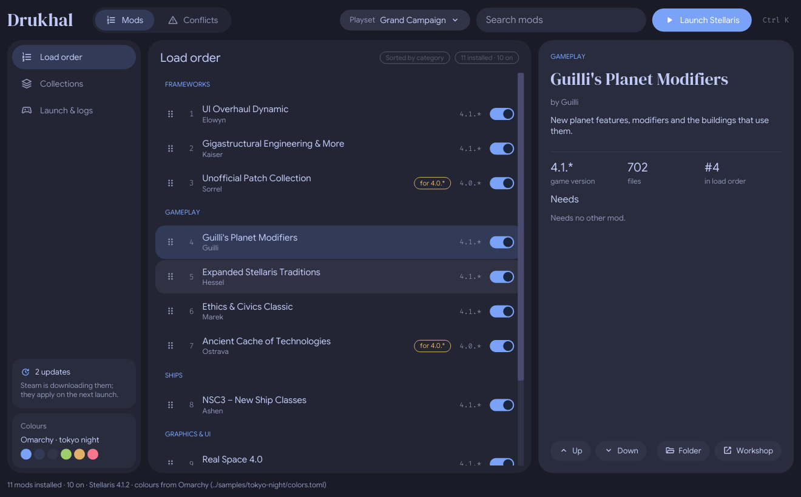 | 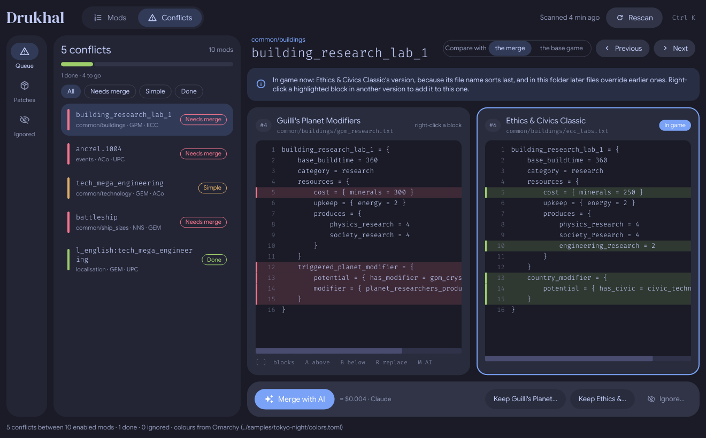 |
| Omarchy Catppuccin Latte | 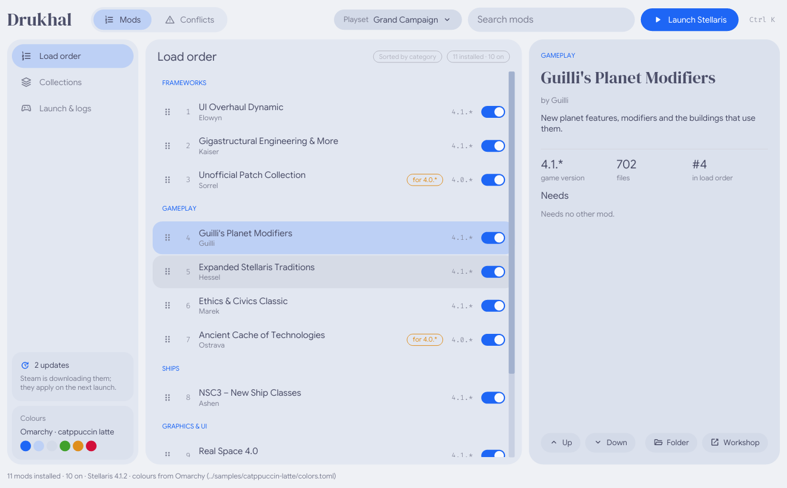 | 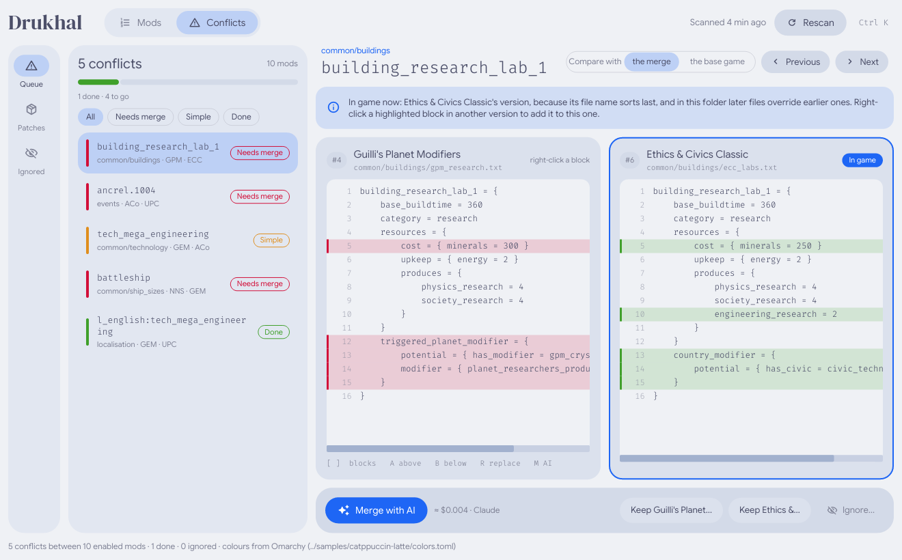 |
| Command palette | 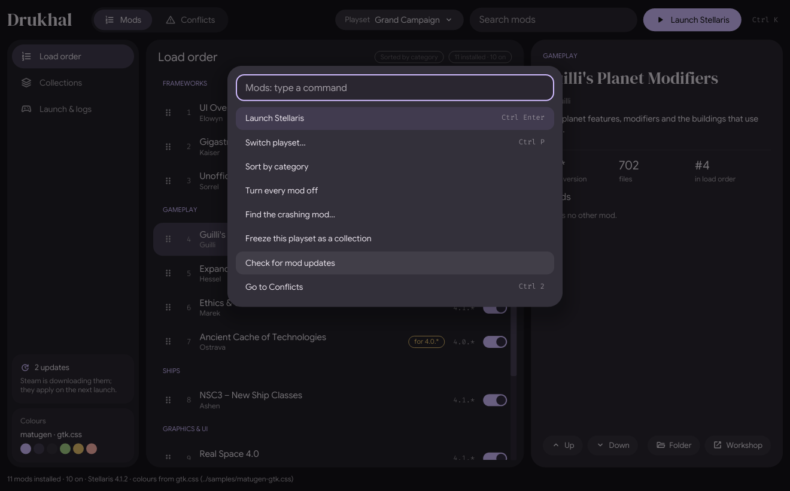 (matugen) | 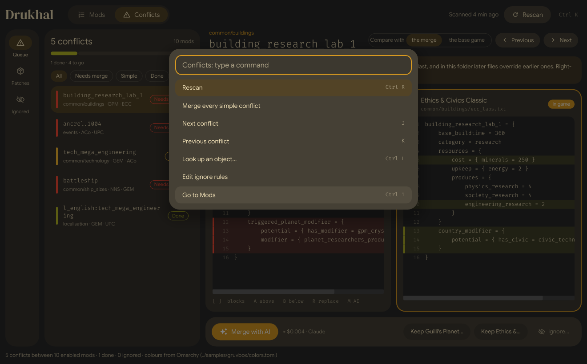 (Omarchy Gruvbox) |
| Dragging / Add above or below | 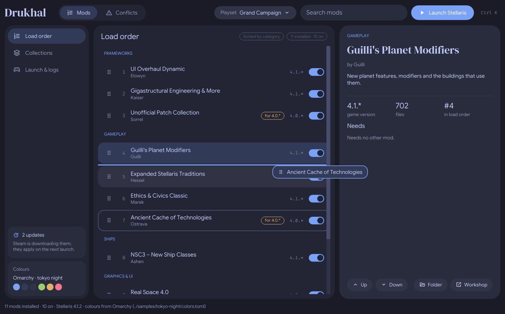 | 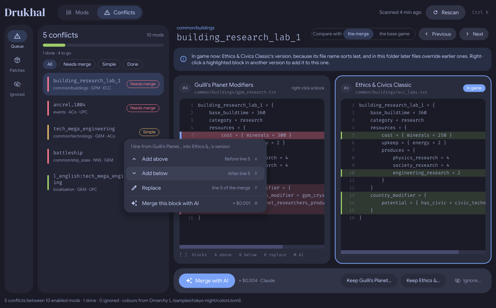 |
| A block added | | 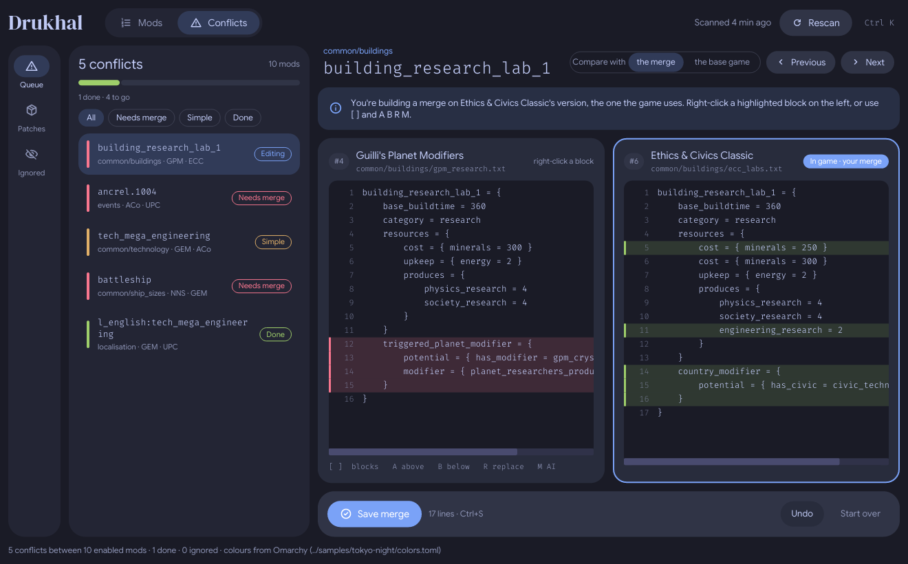 |
| Compared with the base game | | 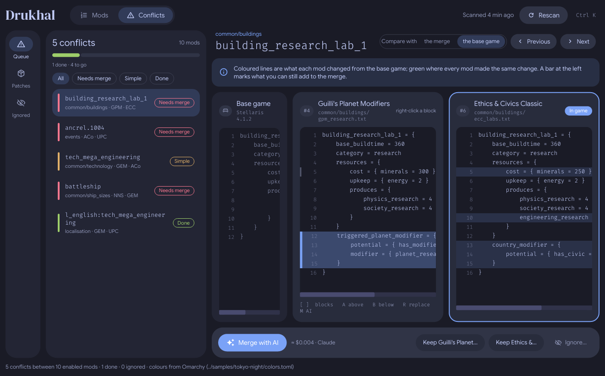 |
| Ignore, with a scope | | 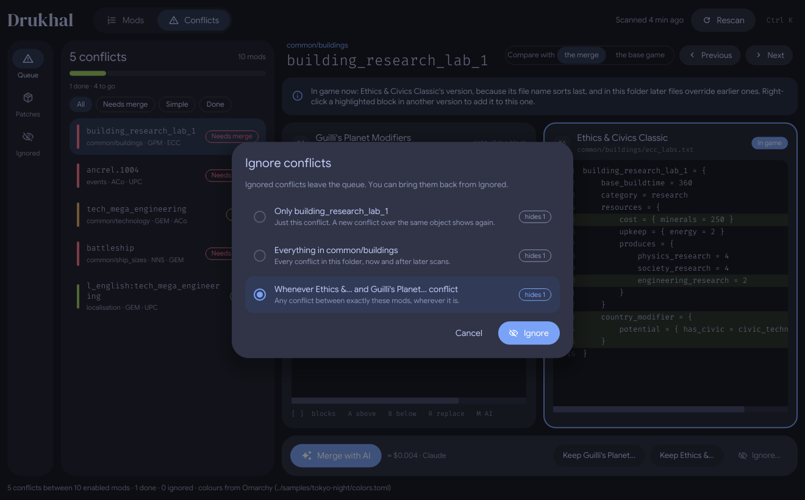 |

## Running

```bash
cd prototypes/iced-workbench && cargo run --release
```

- `--mode conflicts` starts in the Conflicts mode.
- `--palette <file>` uses a specific `gtk.css`, `colors.toml` or Omarchy
  theme folder instead of the desktop's; `samples/` has a few.
- `--commands` opens the command palette.
- `--screenshot <out.png>` saves the first frame and quits; with it,
  `--show menu|added|base|ignore|drag` sets up the context menu, an
  added block, the base game comparison, the ignore sheet or a drag under
  way.

Without a GPU (a VM, CI), `ICED_BACKEND=tiny-skia` uses the software
renderer.
