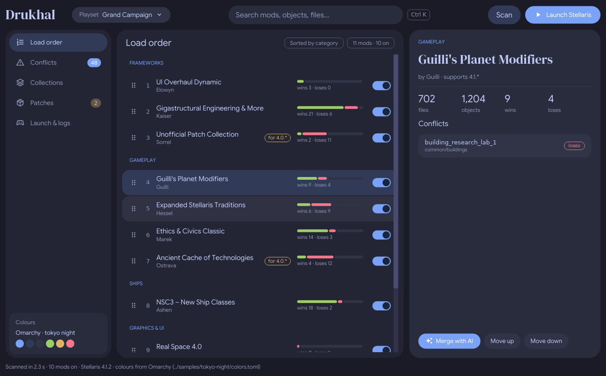
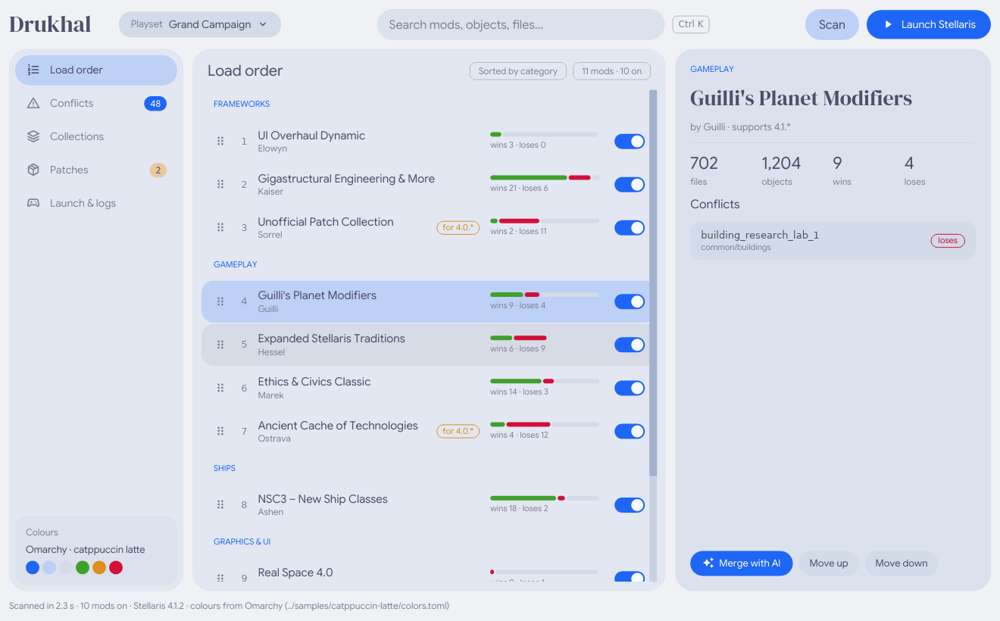
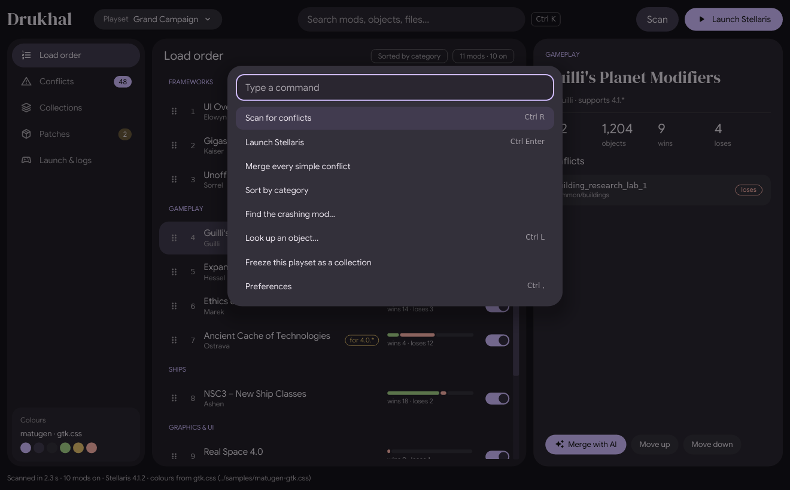
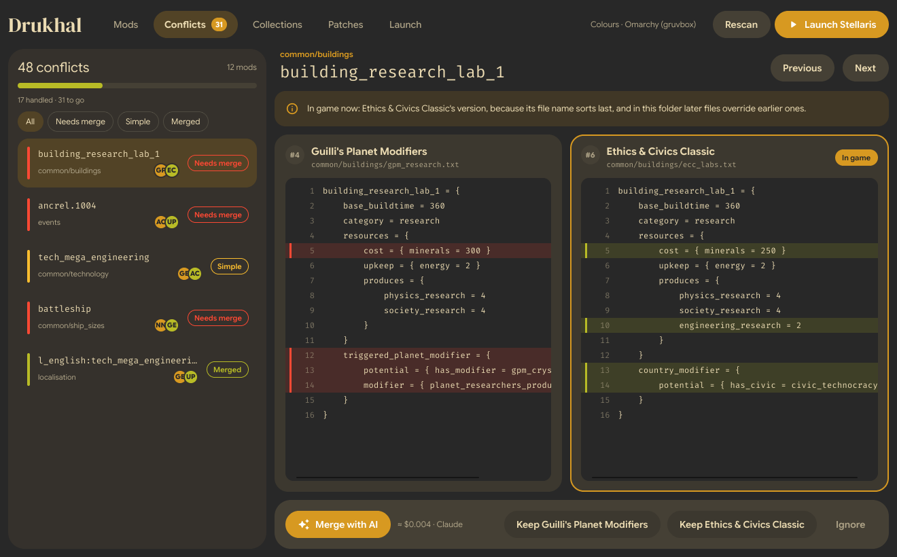
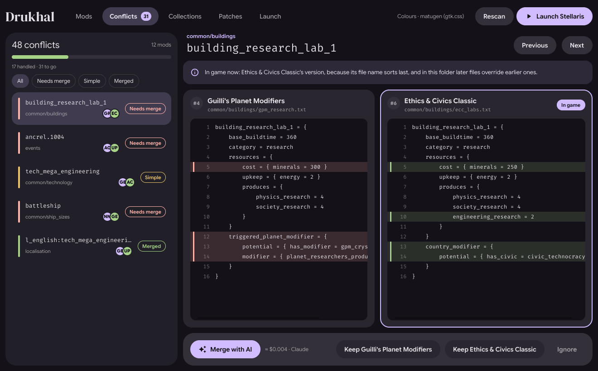
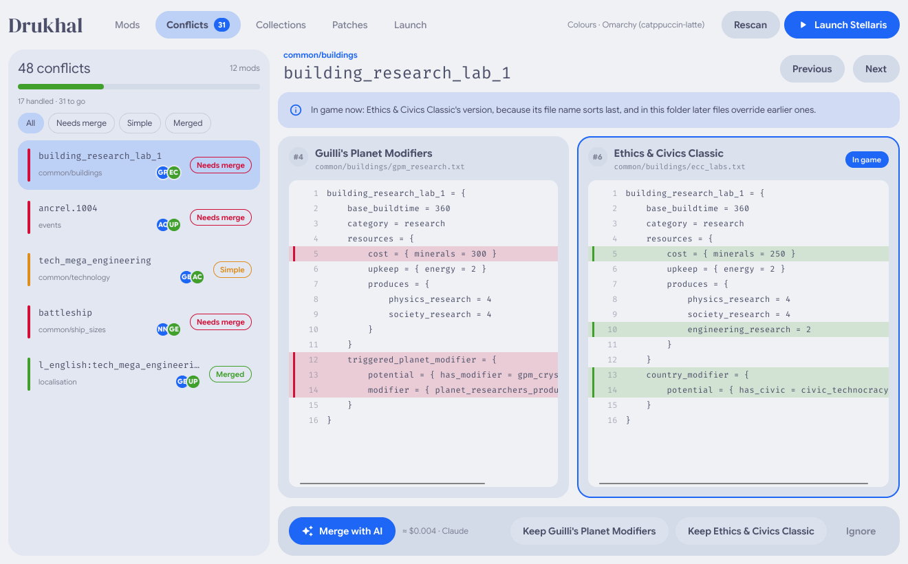

# Native UI prototypes

Two GTK-free mockups of DrukhalManager's main window, to compare toolkits
and layouts before committing to a port. They show sample data only; they
don't read your mods.

| Folder | Toolkit | Layout |
| --- | --- | --- |
| `iced-workbench/` | [iced](https://iced.rs) 0.14 (the toolkit COSMIC is built on) | Three panes: views rail, load order with conflict heat, inspector. Ctrl+K command palette. |
| `slint-resolve/` | [Slint](https://slint.dev) 1.19 | Conflicts first: the conflict queue, the versions side by side with the one the game uses marked, and the merge actions. |

Both take their colours from `palette/`, which reads the same sources the
GTK app does, in the same order, and reloads them live:

1. `~/.config/gtk-4.0/gtk.css`: the `@define-color` lines matugen,
   DankMaterialShell or Gradience write (`accent_bg_color`,
   `window_bg_color`, …).
2. Omarchy's active theme: `~/.local/state/omarchy/current/theme/` or
   `~/.config/omarchy/current/theme/` (`colors.toml`, `light.mode`).
3. A built-in Material 3 dark palette.

## Screenshots

`iced-workbench` with Omarchy's Tokyo Night, Catppuccin Latte (light), and
a matugen palette with the command palette open:





`slint-resolve` with Omarchy's Gruvbox, matugen, and Catppuccin Latte:





## How the toolkits compare so far

- **iced**: everything is Rust, in the Elm style (state, messages,
  `view`). Async work fits through `Task` and `Subscription`, so the
  scan's `spawn_blocking` jobs map over directly. Styling is a closure per
  widget, so the Material look lives in plain Rust helpers. COSMIC is
  built on it, so Wayland, IME and accessibility get steady attention.
- **Slint**: the layout is a separate `.slint` file with live preview in
  its editor tooling. It reads well for dense, designed screens and
  rebinding colours is one global. Its built-in widgets are fewer,
  and anything custom (the diff view, drag reordering) is drawn by hand.
  It's licensed GPLv3, under a royalty-free licence for desktop apps
  (which asks for a visible Slint attribution), or commercially; the
  royalty-free one would cover this app, but read its terms first.
- Both draw the same fonts (Google Sans Flex, Fira Code, DM Serif
  Display) and Material icons the GTK app uses, and both render through
  wgpu/femtovg or a software renderer, so Windows comes along later
  without a second UI.

## Running

```bash
cd prototypes/iced-workbench && cargo run --release
```

```bash
cd prototypes/slint-resolve && cargo run --release
```

`--palette <file>` uses a specific `gtk.css` or `colors.toml` instead, and
`--screenshot <out.png>` saves the first frame and quits. The `samples/`
folder has a few palettes to try.
